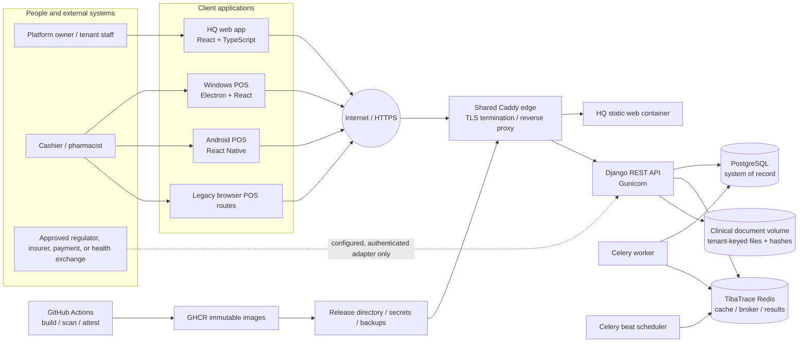

# TibaTrace System Architecture

**Type:** As-built reference diagram  
**Repository snapshot:** source after 26 October 2026 documentation update 
**Production evidence boundary:** server rc71, commit `2965194a29311314e8a5772adfeee5af8c14a8f2`; current live host is Hetzner Nuremberg, Germany. Local commit `f8ea5cd` is not deployed.

## Production deployment shape documented for Esenai

- A shared Caddy edge terminates public HTTPS and routes to TibaTrace services.
- API, worker, beat, and HQ are containerized from immutable backend/HQ images. Release records identify image digests and source revisions.
- The current documented single-host deployment uses a dedicated PostgreSQL 16 database with TLS and a TibaTrace-specific Redis service. PostgreSQL is the system of record; Redis supports cache and asynchronous work.
- Clinical attachments are stored in the `clinical-objects` Docker volume. Current source encrypts new object bytes with AES-256-GCM using a versioned keyring, but the deployment keyring and migration of legacy objects must be verified. Docker volume configuration does not prove host/volume or backup encryption; those controls remain independent.
- Secrets are injected from `/opt/tibatrace/secrets/.env.production`; the release runbook requires restrictive file permissions and keeps it outside release directories.
- CI builds and scans artifacts, publishes them to GHCR and records provenance. Production pulls by digest rather than a floating tag.

## Trust boundaries and data flow

1. A person signs in through HQ session/CSRF authentication or a native POS authentication flow. Requests reach the API through HTTPS.
2. The API resolves the authenticated actor and tenant context, applies capabilities and tenant scoping, then reads/writes PostgreSQL. Workers carry explicit tenant identity for queued work.
3. Clinical attachments are authorized, token-bound to tenant/actor, authenticated-encrypted at rest for new writes, integrity-checked, and audited on access. Legacy files require the documented encryption migration.
4. External integrations are separate trust boundaries. They require an approved endpoint, credentials held outside the database, contract/profile, sandbox validation, and explicit activation. Templates alone do not send data.

## Deployment evidence boundary

The rc71 review establishes the server release and Germany region; owner-confirmed Kenya hosting is not yet arranged. This diagram does not prove physical/database at-rest encryption, approved recovery objectives, native-client version, or a live national-system integration. DHA/RX/checkout activation remains disabled in the reviewed production configuration. Local identifier-key changes in `f8ea5cd` have not changed production behavior.

## Related implementation references

- `deploy/tibatrace/docker-compose.yml`
- `deploy/tibatrace/docker-compose.server.yml`
- `deploy/tibatrace/README.md`
- `backend/dawatrace/urls.py`
- `docs/releases/RC52_RELEASE_VERIFICATION_2026-10-16.md`
- `docs/releases/TIBATRACE_v1.0.0_RC53.md`
